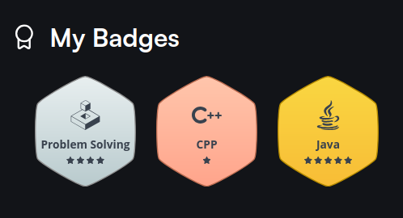

# Servus! 👋

I love mathematics 💜

### 📐 Mathematics & ⚛️ Physics

          

### 💻 Computer science

          

### 🌱 For fun

   

### 🏅 HackerRank

[View my certificate →](https://www.hackerrank.com/certificates/iframe/00c3db86eb2d)

 

